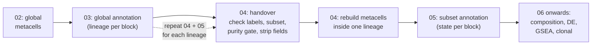
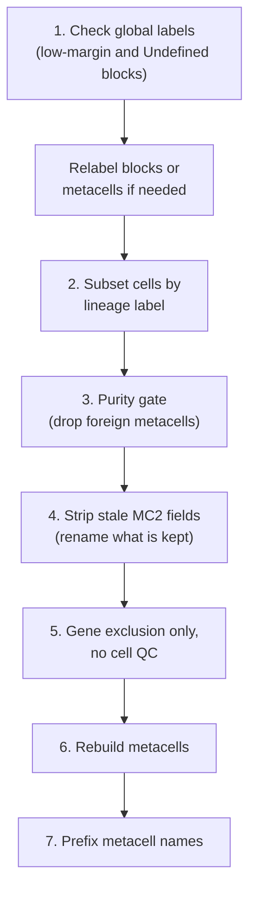

<div align="right">
  <small><em>Author: Saumya Pothukuchi & Claude AI - Opus 4.8 (Anthropic, 2026)</em></small>
</div>

# Two passes

* Metacells are built twice: once on the whole dataset (script 02), then again inside one lineage at a time (script 04).
* [04](04_building_metacells.md) covered the mechanics both runs share. This page covers why the second run exists, and everything script 04 does **before** it rebuilds metacells: the handover from the global run to a subset.
* The handover matters because every mistake made there is silent. A subset built from a wrong label, or on leftover fields from the global run, still runs to completion and still looks normal.



## Why not once

* A single global run with small metacells sounds simpler. It does not work, because of how features are selected.
* MC2 groups cells using the most variable genes ([02](02_metacells.md)). With monocytes, B cells and T cells in one object, the most variable genes are the ones separating lineages (e.g. *LYZ*, *CD79A*, *CD3E*). Those are the genes that get selected.
* Differences between T cell states (naive, memory, cytotoxic) are real but much smaller, so their genes (e.g. *CCR7*, *GZMK*, *GZMB*) rank lower and are largely left out. Metacells are then built without the genes that would have separated the states, however small the metacells are made.
* Subsetting removes the differences between lineages. Feature selection runs again on what is left, and the state genes are now the most variable ones.
* This is the same reasoning as subclustering in a traditional workflow: subset one cluster, re-run HVG selection and PCA, then recluster.


*Left: all lineages together. Lineage genes take every feature slot, and the three T cell states sit on top of each other. Right: T cells only, with features re-selected. The state genes are now selected and the states separate.*

**What to expect on a subset.**
* Fewer selected genes than the global run. This is expected: there is less variation left to select on.
* A higher outlier rate ([04](04_building_metacells.md)).
* Different parameter values throughout ([06](06_parameters.md)).

## The handover

Script 04 does seven things in order. The first four happen on the global object, before any subset exists.



## 1. Checking global labels before subsetting

**Why.**
* Labels are inherited downwards: each block gets a lineage call ([07](07_annotation.md)), every metacell in it inherits that call, and every cell inherits its metacell's.
* A block called on weak evidence therefore moves all of its cells into the wrong subset at once. A block of 150 metacells can be several thousand cells.
* Nothing downstream flags it. The subset looks clean, metacells rebuild without error, and differential expression is run on a contaminated population.

**What the script prints.**
* Every global block, sorted by `score_margin`: the gap between its best and second-best lineage score.
* Blocks under `margin_thresh` (0.5, in `config/config.yaml`) are flagged `low_margin`. `Undefined` blocks are flagged too.
* For flagged blocks only, a table of mean expression on a short marker panel per lineage, so the call can be judged on expression and not only on the score that was already ambiguous.
* The share of all cells sitting in flagged blocks. If this is a fraction of a percent, the default subset is fine as it is.

| Flag | What it means | Usual cause |
|:--|:--|:--|
| Low margin, high best score | Two lineages both fit | Shared markers (NK and cytotoxic T, DCs and monocytes), or a doublet-like block |
| Low best score (`Undefined`) | Nothing fits | No confident identity, or a real population whose markers dropped out or are mostly lateral |

**Fixing a label.**
* `BLOCK_RELABEL` changes a whole block; `MC_RELABEL` changes a single metacell when only part of a block is wrong. The metacell-level change is applied second, so it wins.
* Both are empty by default, which reproduces the global annotation unchanged.
* The original label is kept in `broad_label_original`, and every change is written to the `manual_relabels` sheet of the QC workbook. Keep the same changes in script 03 and rerun its last three chunks ([07](07_annotation.md), Manual curation).

## 2. Subsetting by label

* Cells are kept if their metacell's `broad_label` is in `SUBSET_LABELS`, set at the top of script 04.
* Two groups of cells never enter any subset:
  * **Global outliers.** Cells MC2 could not place in a metacell in the global run ([04](04_building_metacells.md)) have no metacell, so no label. They are labelled `Outlier` and left out. This is typically a few percent of cells, and they are absent from every downstream analysis run on subsets.
  * **`Undefined` blocks**, unless relabelled in step 1.
* Metacells missing from the global heatmap come back as `Unassigned`. That count should be 0; anything else means metacells were lost during script 03.

## 3. The purity gate

### Why a second filter is needed

* A block label applies to every metacell in the block. Blocks are groups of metacells with similar module scores, and the grouping is not perfect.
* If a block of 600 metacells is called "T cells", a handful of monocyte or B cell metacells inside it inherit the label and enter the T cell subset.
* The damage shows up later and is hard to trace: monocyte, B cell and DC gene modules appear in the T cell subset's module heatmap, and take up modules and blocks that should have described T cell states.
* The purity gate checks each metacell individually before it is allowed in.

### How it works

* Each metacell is scored on a short marker panel per lineage (which can always be modified as needed):

| Panel | Genes |
|:--|:--|
| T | `CD3D`, `CD3E`, `CD3G`, `CD2`, `TRAC` |
| Mono | `LYZ`, `S100A8`, `S100A9`, `FCN1`, `CD14`, `CST3`, `AIF1`, `LST1` |
| B | `MS4A1`, `CD79A`, `BANK1`, `IGKC` |
| DC | `CD1C`, `FCER1A`, `CLEC4C`, `LILRA4`, `IRF8` |
| Plt | `PPBP`, `PF4`, `PF4V1`, `TREML1` |
| HSPC | `CD34`, `PROM1` |

* A score is the metacell's average expression of the panel's genes (log-normalised, CP10K).
* A metacell passes if it clears two separate thresholds (shown here for a T cell subset):

```python
T_MIN, OTHER_MAX = 0.3, 0.4        # purity_min, purity_other_max in config.yaml
mc_pure = (panel_mc["T"] >= T_MIN) & (other <= OTHER_MAX)
```

  * **Lineage floor (`purity_min`):** its own lineage panel is at least 0.3. It carries the lineage's signal.
  * **Foreign ceiling (`purity_other_max`):** its highest-scoring other panel is at most 0.4. It carries no other lineage's program.


*One dot per metacell labelled as this lineage. Metacells in the shaded region pass. Red dots above the dashed line carry another lineage's program; red dots left of the dotted line carry no lineage signal.*

### Why two thresholds and not a margin

* The obvious alternative is a single rule on the gap: own score minus highest foreign score.
* A gap depends on depth. A shallow metacell has low scores on everything, so its gap is small even when it is clean.
* *Example:* a metacell with T = 0.40 and Mono = 0.07 has no monocyte signal, but its gap is only 0.33. A margin rule of 0.5 would drop it. A deeper metacell with T = 1.60 and Mono = 0.90 is clearly contaminated, yet its gap of 0.70 would pass.
* Two absolute thresholds ask two separate questions: "does it have this lineage's signal?" and "does it have another lineage's signal?". The blue dots in the figure are the clean, shallow metacells a margin rule would have lost.

### Checking the gate is set correctly

The script prints three diagnostics. Read all three before accepting the subset.


**1. Failure rate per block.**
* **Diffuse** (left panel): a few percent failing across many blocks. These are stray metacells, which is what the gate is for.
* **Concentrated** (middle panel): one block failing at a very high rate. The block's label is wrong. Fix the label in step 1 instead of letting the gate remove most of the block.

**2. Mean panel scores of the dropped metacells.**
* Dropped metacells should look foreign: high on Mono, B or DC.
* If they are low on everything, including their own lineage, the floor is too high and real, shallow metacells are being lost. Lower `purity_min`.

**3. Distribution of the highest foreign score.**
* Printed at several percentiles (50th to 99th) for metacells in the lineage's blocks.
* Clean metacells sit at a low, flat level; contaminated ones rise sharply at the top end. Set `purity_other_max` in the gap between the two (right panel), instead of picking a round number.

The script also prints how many cells the label alone selected, and how many remain after the gate. A drop of a few percent is typical. The per-block table is written to the `purity_gate` sheet of the QC workbook.

### Things to know

* **NK markers are reported but never gated on.** Markers such as `KLRD1` (CD94) are also expressed by CD8 effector-memory, Temra and gamma-delta T cells, so gating on them rejects real T cell blocks. The T versus NK decision is made at block level in script 03 by the CD3 veto ([07](07_annotation.md)).
* **The panels are written for a T cell subset.** For another lineage, change which panel counts as its own (e.g. Mono for a myeloid subset, with T becoming a foreign panel), and re-read the three diagnostics. The thresholds will not transfer either.
* **The floor matches script 05.** A block with T core expression under the same 0.3 is labelled `Non-T` there ([07](07_annotation.md)), so the two scripts cannot disagree about what counts as a T cell.

> [!TIP]
> Do not relabel a borderline block to move more cells into a subset. A contaminated block harms differential expression more than a slightly smaller subset does.

## 4. Stripping stale MC2 fields

**The problem.**
* MC2 writes its results onto the object as it runs: metacell assignments, gene masks, rare gene modules.
* It does not clear them when run again. If these fields survive from the global run into the subset object, MC2 reuses them instead of recomputing.
* The result is the worst kind of failure: the run completes, the output looks normal, and the subset metacells were built on the **global** feature selection. That removes the whole reason for the second pass, and nothing reports it.

**What script 04 does.**

| Action | Fields | Why |
|:--|:--|:--|
| Renamed with a `global_` prefix, originals deleted | `metacell`, `metacell_name`, `metacell_level`, `dissolved`, `most_similar`, `most_similar_name` | Worth keeping for traceability, but must not be read as this run's results |
| Deleted (cells) | `excluded_cell`, `clean_cell`, `rare_cell`, `rare_gene_module`, `pile`, `candidate`, QC flags | Belong to the global run |
| Deleted (genes) | `excluded_gene`, `lateral_gene`, `noisy_gene`, `selected_gene`, `rare_gene`, `rare_gene_module` | Gene masks must be recomputed on the subset |
| Cleared | `obsp`, `varp`, `uns` | Stored graphs and settings from the global run |
| Kept on purpose | `global_broad_label`, `global_mc_block`, `global_anno_margin` | Trace each cell back to its global block and label |

* The script prints what was dropped and what remains. After this step, no column should carry an MC2 name without the `global_` prefix.

## 5. No cell QC on the subset

* Script 04 does not filter cells. Every cell arriving here already passed the global filters ([04](04_building_metacells.md)).
* Filtering again would judge cells against a different population. Data-driven filters such as MAD set their thresholds from whatever cells are present.
  * *Example:* naive T cells have fewer detected genes than monocytes. Against the whole dataset they are unremarkable. In an object made only of deeper cells, the same cells can look like low-quality outliers and be removed, although nothing about them changed.
* `excluded_cell` is set to all `False`, so `extract_clean_data()` finds the field it expects and only the gene filter acts.

**Two gene-level details.**
* **Zero-count genes are excluded.** Subsetting to one lineage leaves several thousand genes with no UMIs at all. They carry no information, and they distort the noise curve fitted in script 05 ([06](06_parameters.md), HVG thresholds).
* **Percent mito is not recomputed.** The mitochondrial genes were removed by the global run, so recomputing would report 0% for every cell. The global value is carried over as `global_percent_mito`.

## 6. Rebuilding metacells

From here the run follows [04](04_building_metacells.md), with these differences:

| | Global (script 02) | Subset (script 04) |
|:--|:--|:--|
| Gene lists | Excluded, lateral, noisy | Same lists, re-applied ([05](05_gene_lists.md)) |
| Feature selection | On all cells | Re-run on the subset |
| Metacell size and UMI target | Set for the whole dataset | Re-derived from the subset's own UMI printout ([06](06_parameters.md)) |
| Divide and conquer | Always | Only above `2 x min_pile` cells; otherwise all cells at once |
| Leak check | Lateral genes | Lateral genes, plus TCR V/J segments by name |

* The lateral list matters more here than globally. Inside one lineage, clonal TCR signal is one of the largest sources of variation left ([05](05_gene_lists.md)).
* **Rare gene modules double as a contamination check.** A rare module made of another lineage's genes means foreign cells got past the gate. Script 04 tabulates rare modules against global block and label; those cells can be listed in `RARE_CELLS_TO_DROP` and the run repeated from step 2.

## 7. Metacell name collisions

* MC2 names metacells `M1`, `M2`, ... in every run. Global metacells and each subset's metacells therefore share names.
* Everything downstream joins tables on `metacell_name`. Combining a subset table with the global one, or two subsets with each other, would match unrelated metacells without any error.
* Script 04 adds a prefix where the names are created:

```python
metacells.obs_names = [f"{MC_PREFIX}{n}" for n in metacells.obs_names]   # e.g. T_M1, T_M2
```

* Set `mc_prefix` in `config/config.yaml`, one per lineage (e.g. `T_`, `My_`, `B_`). Script 05 prefixes block numbers the same way (`BLOCK_PREFIX`), so subset block `T_7` cannot be confused with global block `7`.
* Prefixing once at the source means every table, Seurat object and CSV downstream carries unambiguous IDs.

## What changes in script 05

The same machinery as script 03, with different settings and different scoring rules:

| | Global (03) | Subset (05) | Details |
|:--|:--|:--|:--|
| HVG mean threshold | -9 | Re-derived from `range(x)` | [06](06_parameters.md) |
| HVG varmean threshold | 3.67 | Much lower (about 1.3) | [06](06_parameters.md) |
| Modules (`NCLUST`) | 100 | 90 | [06](06_parameters.md) |
| Blocks | 40 | 25 | [06](06_parameters.md) |
| Marker signatures | Lineages | States within the lineage | [07](07_annotation.md) |
| Scoring | Per signature, centred on the mean | Per gene, centred on the median | [07](07_annotation.md) |
| Extra checks | CD3 veto | `Non-T` check, adjacent states, CD4/CD8 axis | [07](07_annotation.md) |

* As a final check, script 05 prints `global_broad_label` for the cells in the subset. Every cell should carry the lineage that was subset.

## Tracing a subset cell back

Every cell in a subset object keeps its history from the global run:

| Column | Contents |
|:--|:--|
| `global_metacell_name` | The cell's metacell in the global run |
| `global_mc_block` | That metacell's global block |
| `global_broad_label` | The lineage label that put the cell in this subset |
| `global_anno_margin` | How confident that block's lineage call was |
| `global_percent_mito` | Percent mito, computed before mitochondrial genes were removed |

## Running more than one lineage

Scripts 04 and 05 are run once per lineage. For each one, change:

| Setting | Where | Example |
|:--|:--|:--|
| `SUBSET_LABELS` | Top of script 04 | `["T cells"]`, `["Mo/Macs", "moDCs"]` |
| `mc_prefix` | `config/config.yaml` | `T_`, `My_` |
| Own-lineage purity panel and thresholds | Script 04, purity gate | T for T cells, Mono for myeloid |
| Output folder and file names | Scripts 04 and 05 | One folder per lineage, so runs do not overwrite each other |
| Metacell size and UMI target | `config/config.yaml` | From the subset's UMI printout |
| HVG thresholds, `NCLUST`, blocks, signatures | Script 05 | Re-tuned per lineage ([06](06_parameters.md)) |

## Before trusting a subset

| Check | Expected |
|:--|:--|
| Cells in flagged blocks reviewed | Each low-margin block kept, relabelled or left out on purpose |
| `Unassigned` cells | 0 |
| Purity failures per block | Diffuse, not concentrated in one block |
| Dropped metacells | Look foreign, not merely shallow |
| Stale fields | No MC2 column left without a `global_` prefix |
| Lateral and TCR V/J leak checks | Both empty |
| Rare gene modules | None made of another lineage's genes |
| `global_broad_label` table in script 05 | Only the lineage that was subset |
