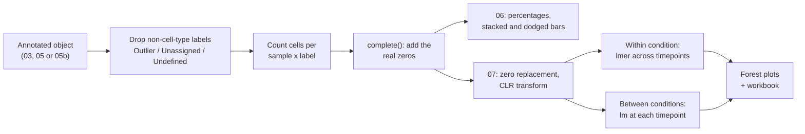
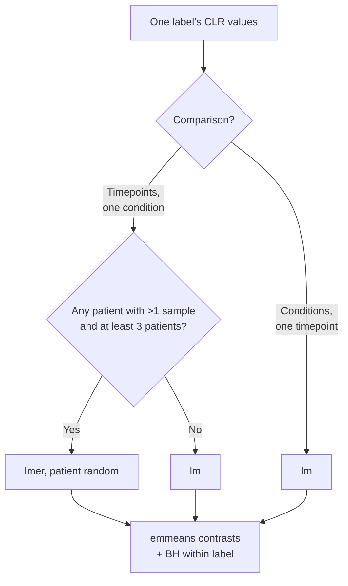

<div align="right">
  <small><em>Author: Saumya Pothukuchi & Claude AI - Opus 4.8 (Anthropic, 2026)</em></small>
</div>

# Composition

* Annotation ([07](07_annotation.md)) gave every cell a label: `broad_label` from the global run, `cluster_label` from a subset run.
* This page covers the first question asked of those labels: **how much of each cell type or state is there, and does that change between conditions or over time?**
* Two scripts answer it:
  * **Script 06** (`scripts/06_composition_stacked_bars.Rmd`) is descriptive: per-sample tables and stacked bar plots.
  * **Script 07** (`scripts/07_composition_clr_models.Rmd`) is inferential: the proportions are transformed with the centred log-ratio (CLR) and tested with linear and mixed models.
* Both scripts run on either level of annotation. One variable at the top of each file chooses which object is read:

```r
LEVEL <- "subset"   # "global", "subset", or "subset_reuse" (see 08b)
```

| | Traditional workflow | This pipeline |
|:--|:--|:--|
| Unit counted | Cells, by cluster | Cells, by the block label each cell inherited from its metacell |
| Summary per group | Often pooled cells | Mean of each donor's own percentage |
| Test | Often a t-test or Wilcoxon on raw percentages | CLR transform, then a mixed model (repeated samples) or a linear model (one sample per patient) |



## 1. Count cells, not metacells

**Why the cell is the counting unit.**
* A metacell is an annotation device: it is how cells got their labels. It is not a sampling unit for abundance.
* Counting metacells instead of cells would be wrong in two separate ways:
  * **Metacell number does not follow abundance.** MC2 sizes each metacell to a cell target and a UMI target ([06](06_parameters.md)). Populations with shallow libraries need more cells to reach the UMI target, so they form fewer metacells per cell than deep populations.
  * **A metacell has no single sample of origin.** MC2 does not use sample labels, so one metacell can pool cells from several samples, timepoints and donors ([02](02_metacells.md)).
* Each cell therefore carries its metacell's block label, and every frequency is computed over cells.


*Simulated sample of 10,000 cells. Population 3 has shallow libraries, so each of its metacells needs about 60 cells to reach the UMI target. Counted by metacells, it shrinks from 20% to 9% of the sample, with no change in the cells.*

## 2. Remove labels that are not cell types

* Three labels describe what happened to a cell during metacell building or annotation, not what the cell is:

| Label | Meaning | Where it comes from |
|:--|:--|:--|
| `Outlier` | MC2 could not place the cell in any metacell | [04](04_building_metacells.md) |
| `Unassigned` | The cell's metacell never reached the module heatmap (should be 0) | [07](07_annotation.md) |
| `Undefined` | The cell's block had no confident call | [07](07_annotation.md) |

* These are listed once in `config/config.R` (`drop_labels`) and removed before any proportion is calculated.
* **Removing them is only harmless if the drop rate is similar across samples.** If one condition loses 15% of its cells to `Outlier` and the other loses 5%, every proportion below differs between the conditions for that reason alone.
* Script 06 prints the drop rate per sample and per condition before anything else. This is the first table to read.

```
  sample_origin condition timepoint n_cells n_dropped pct_dropped
          P7_T2      CASE        T2    4210       421       10.00
          P3_T1      CTRL        T1    5034       287        5.70
  ...
  condition mean_pct_dropped min_pct_dropped max_pct_dropped
       CTRL             6.10            4.80            7.90
       CASE             6.90            5.20           10.00
```

* Means within about a percentage point of each other, and no single sample far above the rest, is what an acceptable table looks like.

> [!NOTE]
> On a rerun subset ([08b](08b_rerun_or_reuse.md)), cells can become outliers a second time when metacells are rebuilt, so the subset drop rate is usually higher than the global one. On a reuse subset no new outliers are created. Compare drop rates within one approach, not across them.

## 3. Every label in every sample: `complete()`

**The problem.**
* Cell counts are built by counting cells per sample and label. A label with no cells in a sample produces **no row at all**, not a row with 0.
* A missing row is not the same as a zero. Left missing:
  * The mean for a rare label is taken only over donors who happen to carry it, so it is inflated.
  * Per-group percentages no longer add up to 100.
  * A stacked bar drawn with `position = "fill"` silently rescales to 100, so the error is invisible.

**Worked example.** Three donors, and a rare state present in only one of them at 6%:
* Without the zeros, the group mean is 6% (one value).
* With the zeros, the group mean is (6 + 0 + 0) / 3 = 2%.
* The first number overstates the state threefold.

**The fix.**

```r
dplyr::count(sample_origin, cell_label) %>%
  tidyr::complete(sample_origin, cell_label, fill = list(n = 0))
```

* `complete()` adds every missing sample and label combination with a count of 0.
* Both scripts then check that the result is right rather than assuming it:

```r
stopifnot(all(abs(tapply(d$mean_pct, d$grp, sum) - 100) < 1e-6))
```

* Bars are drawn with `position = "stack"`, not `"fill"`. If the means ever stop adding up to 100, the bars visibly fall short or overshoot instead of being rescaled.

> [!WARNING]
> Coerce `sample_origin` and `condition` to character before `complete()`. Unused factor levels left over from an earlier subset make `complete()` invent rows for samples that are not in this object.

## 4. Donor weighting (script 06)

* Each bar is the **mean of each donor's own percentage**, not the percentage of all cells pooled together.
* Pooling lets whichever sample yielded the most cells dominate the answer. Averaging per donor gives every donor equal weight.


*Simulated: three donors with similar composition and one donor captured ten times more deeply with a different composition. Pooled, state X looks like 61% of the group; donor-weighted, it is 40%.*

**Figures script 06 writes.**

| Figure | Each bar is | Use it for |
|:--|:--|:--|
| By patient | Mean over that patient's timepoints | Spotting one patient unlike the rest |
| By condition | Mean over all samples in the condition | Headline comparison |
| By sample | One sample | Checking individual samples, finding outliers |
| By condition and timepoint | Mean over donors at that timepoint | Trajectories |
| Dodged, label by condition | Mean with SEM error bar | Comparing one label between conditions |

* The same numbers behind each figure are written to `<prefix>_composition_summaries.xlsx`, one sheet per figure plus the drop table.
* Bar colours are matched to labels by name within a run, but assigned in alphabetical order of the labels present. A run with a different label set can therefore give the same label a different colour; key the palette to fixed label names when figures from several runs must match.

## 5. Why proportions cannot be tested directly

**Proportions are compositional.**
* Within a sample, proportions must add up to 100. A real increase in one population therefore forces the proportions of all the others down, whether or not anything happened to them.
* A t-test or Wilcoxon on raw percentages tests each population separately, as if they were independent. They are not, and populations that did not change come out as "decreased".


*Simulated: population A triples between T0 and T1. B, C and D do not change at all (panel 1). As proportions, B, C and D each appear to fall by 6 to 9 percentage points (panel 2). After CLR, A stands out and B, C and D share one small, identical shift (panel 3).*

### The centred log-ratio

**What it does, step by step.** For each sample separately:
1. Take the geometric mean of all its population proportions (the typical population size in that sample).
2. Divide each population's proportion by that geometric mean.
3. Take the log.

**Worked example** (the T0 sample from the figure: A 20%, B 30%, C 30%, D 20%):
* Geometric mean of 20, 30, 30 and 20 is about 24.5.
* A: log(20 / 24.5) = -0.20. B: log(30 / 24.5) = +0.20. C: +0.20. D: -0.20.
* At T1 (A 42.9%, B 21.4%, C 21.4%, D 14.3%), the geometric mean is about 23.0, and the CLR values are A +0.62, B -0.07, C -0.07, D -0.48.
* T1 minus T0: A +0.82; B, C and D each -0.27.

**How to read a CLR value.**
* A CLR value is a population's abundance **relative to the typical population in the same sample**. 0 means "as abundant as the sample's typical population"; positive means more, negative means less.
* CLR does not recover absolute counts; nothing can, from proportions alone. What it does is take the values out of the add-to-100 constraint, so standard linear models are valid on them.
* The unchanged populations still move, but they all move by the **same** amount. A population that changed is the one that moves differently from the rest.
* A positive CLR difference means that population grew relative to the sample's typical population. It does not mean its absolute count rose. This belongs in every figure legend.

### Zeros

* The log of 0 is minus infinity, so a single zero would break every model that sample enters.
* Script 07 replaces each zero with **half the smallest non-zero proportion in the same sample**, then rescales that sample back to 100. This is the standard multiplicative replacement for compositional data.
* The number of replaced zeros is printed:

```
Structural zeros in the sample x cluster table: 14 of 392
```

* A handful is normal. If zeros make up a large share of the table, the label set is too fine for the number of cells per sample. Merging labels is the correct fix; leaning harder on the replacement is not.

### Label names survive the transform

```r
clr_long <- tibble::as_tibble(clr_tab, .name_repair = "minimal")
```

* `as.data.frame()` on a matrix runs `make.names()` on column names, turning a label like `CD4/CD8-amb Exhausted/Act` into `CD4.CD8.amb.Exhausted.Act`. Every later join back to the label set then fails without an error.
* `as_tibble()` with minimal repair keeps names exactly as they were. The script also checks that the CLR label set equals the original label set, and that every sample's CLR values sum to zero.

## 6. The models (script 07)

Which model applies depends on whether the same patient appears more than once in the comparison.

| Comparison | Model | Why |
|:--|:--|:--|
| Timepoints within one condition | `lmer(clr ~ timepoint + (1 \| patient_id))` | The same patient is sampled at several timepoints, so their samples are not independent. Patient enters as a random intercept. |
| Conditions at one timepoint | `lm(clr ~ condition)` | Each patient contributes one sample at that timepoint. There is nothing to pair. |



**What a random intercept does here.**
* Some patients have generally more of a population than others, at every timepoint. Without accounting for this, that patient-to-patient spread is treated as noise and hides real changes over time.
* A random intercept lets each patient have their own baseline level, so the timepoint effect is estimated from changes **within** patients.
* The model used for each label is recorded in a `model` column. A label falling back to `lm` where `lmer` was expected means the repeated sampling was not there for it.

**Timepoints with too few patients.**
* A timepoint needs at least `MIN_PATIENTS_PER_TP` (2) patients in a condition to enter that condition's model.
* Thin timepoints are removed **before** fitting, not filtered out of the results afterwards. Removed afterwards, they still distort the fit and can produce contrasts that rest on a single sample.
* Script 07 prints the patients available per condition and timepoint, and which timepoints are usable.

**Contrasts and multiple testing.**
* Contrasts come from `emmeans`: every pair of timepoints within a condition (later minus earlier), and CASE minus CTRL at each timepoint both conditions share.
* P-values are BH-adjusted within each label, over that label's contrasts.

> [!WARNING]
> Attach `lmerTest`, not only `lme4`. Without it, `anova()` on an `lmer` fit has no p-value column, and `emmeans` switches to large-sample approximations that are too optimistic with 3 to 5 patients per group.

## 7. Reading the output


*Simulated forest plot. Each row is a state, each point is one timepoint compared with T0, and bars are 95% confidence intervals. Stars mark BH-adjusted p < 0.05. Here the cytotoxic state rises at T2 and T3 while the naive state falls; memory and Treg do not move.*

* **A point to the right of the dashed line** means the state is more abundant relative to the sample's typical population than at the reference.
* **An interval crossing zero** means the data are compatible with no change.
* **Opposite movements in two states** (cytotoxic up, naive down in the example) can be one real change plus the shared shift described in section 5. Check both states' cell counts before reporting both as changes.

**Figures and tables.**

| Output | Contents |
|:--|:--|
| Forest plot, relative to T0, one per condition | Each later timepoint against T0 |
| Forest plot, all pairwise timepoints | Every pair, one panel per contrast |
| Forest plot, CASE vs CTRL | One panel per shared timepoint |
| `<prefix>_CLR_timepoint.xlsx` | Sheets `within_CTRL`, `within_CASE`, `CASE_vs_CTRL_by_tp`, `means` (estimated marginal CLR means), `availability` (patients per condition and timepoint) |

## Alternatives

CLR with a mixed model is a light, transparent option. Two dedicated methods handle compositional single-cell data with more machinery and are worth knowing about:

| Method | Approach | When it may be preferable |
|:--|:--|:--|
| [propeller](https://doi.org/10.1093/bioinformatics/btac582) (Phipson et al. 2022) | Transforms proportions (arcsine square root or logit), then linear models with empirical Bayes | Many cell types, simple designs, a `limma`-style workflow |
| [scCODA](https://doi.org/10.1038/s41467-021-27150-6) (Büttner et al. 2021) | Bayesian model with a reference cell type that is assumed unchanged | A cell type is known to be stable and can serve as the reference |

## Before trusting a composition result

| Check | Expected |
|:--|:--|
| Drop rate per sample and condition | Similar across conditions, no sample far above the rest |
| Percentages per sample and per group | Add up to 100 (asserted) |
| Structural zeros | A small share of the table |
| CLR values per sample | Sum to 0 (asserted) |
| `model` column | `lmer` wherever patients were sampled repeatedly |
| Patients per timepoint | At least `MIN_PATIENTS_PER_TP` in every timepoint that was tested |
