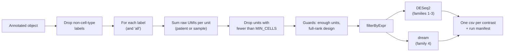

<div align="right">
  <small><em>Author: Saumya Pothukuchi & Claude AI - Opus 4.8 (Anthropic, 2026)</em></small>
</div>

# Differential expression

* Composition ([09](09_composition.md)) asked whether a population becomes more or less abundant. This page covers the other main question: **within a population, which genes change between conditions or over time?**
* Script 08 (`scripts/08_pseudobulk_degs.Rmd`) answers it with **pseudobulk** differential expression: counts are summed per donor or sample, and the summed profiles are tested with DESeq2, or with `dream` for the one design DESeq2 cannot fit.
* Metacells play the same role here as in composition: they produced the labels that decide which cells are summed together. They are **not** the unit of testing. A metacell pools cells across donors ([02](02_metacells.md)), so it is not a replicate of anything.
* The script runs on the global or a subset object (`LEVEL` at the top), for every label separately and once for all cells pooled (the `all` unit).

| | Traditional (`FindMarkers`) | This pipeline |
|:--|:--|:--|
| Replicate | Each cell | Each patient, or each sample, depending on the comparison |
| Test | Wilcoxon on single cells | Negative binomial model (DESeq2) on summed counts, or a linear mixed model (`dream`) |
| Repeated samples from one patient | Ignored | Paired design, or patient as a random effect |
| Effect size reported | Unshrunken log fold change | Shrunken log fold change for plots; unshrunken Wald statistic for ranking |



## 1. Why pseudobulk

**The replicate is the donor, not the cell.**
* Cells from one donor share that donor's genotype, age, sample handling, dissociation and disease state. They are not independent observations of a condition effect.
* A test that treats each cell as a replicate counts several thousand related observations as several thousand independent ones. It then finds "significant" differences that are only donor-to-donor variation.
* This is well established in benchmark studies ([Squair et al. 2021](https://doi.org/10.1038/s41467-021-25960-2); [Zimmerman et al. 2021](https://doi.org/10.1038/s41467-021-21038-1); [Murphy and Skene 2022](https://doi.org/10.1038/s41467-022-35519-4)).


*Simulated: two arms of three donors, 150 cells each, and no real difference between arms; donors only differ from each other the way real donors do. Testing cells (left) calls 63% of genes significant. Testing summed donor profiles (right) calls about 5%, which is what a correct test should give when nothing is different.*

**What pseudobulk does.**
* Raw UMI counts are summed across all cells of one label within one unit (a patient, or a sample). Each unit becomes one column, exactly like a bulk RNA-seq sample.
* Bulk RNA-seq tools then model donor-to-donor variation properly, because each donor appears as one observation.

## 2. Which unit is the replicate

This depends on the comparison, and choosing the wrong unit is the most common mistake after not pseudobulking at all.

| Comparison | What varies | Unit | Design |
|:--|:--|:--|:--|
| CASE vs CTRL, all timepoints pooled | Between patients | Patient (timepoints summed together) | `~ condition` |
| Timepoint vs timepoint, within one condition | Within patients | Sample, paired by patient | `~ patient_id + timepoint` |
| CASE vs CTRL, at one timepoint | Between patients | Sample (one per patient) | `~ condition` |
| Does CASE change differently from CTRL over time? | Both | Sample, patient as a random effect | `~ condition * timepoint + (1 \| patient_id)` |

## 3. The four contrast families

**Family 1: condition (CASE vs CTRL, pooled).**
* The headline comparison. Condition differs between patients, so the patient is the unit, and all of a patient's timepoints are summed into one profile.
* *Example:* 5 CTRL and 3 CASE patients give 8 columns, one per patient.

**Family 2: timepoints within a condition (paired).**
* Every pair of timepoints is compared inside each condition, later against earlier.
* Only patients sampled at **both** timepoints of a pair are kept. That is what makes `~ patient_id + timepoint` a true paired design: each patient is compared with themselves.
* *Worked example*, comparing T2 with T0 inside CTRL:

| Patient | T0 | T2 | Kept for T2 vs T0 |
|:--|:--|:--|:--|
| P1 | yes | yes | yes |
| P2 | yes | yes | yes |
| P3 | yes | yes | yes |
| P4 | no | yes | no: no T0 to pair with |
| P5 | yes | yes | yes |

* A patient seen at only one of the two timepoints carries no information about the change, and leaving them in makes the design impossible to fit.
* The script checks pairing again **after** the minimum-cell filter (section 4). A patient can lose one of their two samples to that filter, which silently breaks the pairing if it is not re-checked.

**Family 3: CASE vs CTRL at each timepoint (unpaired).**
* Each patient contributes one sample at a given timepoint, so there is nothing to pair.
* Timepoints where either arm has too few patients are skipped by the guards rather than fitted.

**Family 4: the interaction.**
* Families 1 to 3 never ask whether CASE **changes differently** from CTRL over time:
  * Family 1 collapses time.
  * Family 2 looks inside one condition at a time.
  * Family 3 looks at one timepoint at a time.
* The interaction asks how much more the two arms differ at a later timepoint than they already did at the reference timepoint: the difference of differences.


*Left: both arms rise by the same amount; family 2 finds the change in both conditions, but there is no interaction. Right: CASE rises much more than CTRL; the interaction at T2 is the gap at T2 minus the gap at T0.*

## 4. Building the pseudobulk matrix

**Summing counts.**
* Raw UMIs are summed with a sparse matrix product, one column per unit. The script checks that the counts layer holds whole numbers (raw UMIs, not normalised values) before anything else.

**Minimum cells per unit: `MIN_CELLS` (20).**
* A unit built from very few cells is mostly noise, but enters the model with the same weight as one built from thousands.
* *Example:* a sample with 4 cells of a rare state would contribute one column summed from 4 cells. It is dropped instead.

**Gene filtering: `edgeR::filterByExpr`.**
* Removes genes with too few counts to test, using the design to decide how many units must express a gene. Preferred over a fixed rule such as "expressed in 10% of cells", because it adapts to group sizes and library sizes.
* `MIN_COUNT` (10) is the count a gene needs in enough units; `MIN_TOTAL_COUNT` (15) is the total it needs across all units.

## 5. The guards

* A comparison the data cannot support should be **skipped and recorded**, not fitted into a misleading table. Every guard below returns nothing instead of a result, and the skip is written to the manifest (section 7):

| Guard | Fires when | Why |
|:--|:--|:--|
| Fewer than 2 units | The label is too rare | Nothing to compare |
| Fewer than `MIN_UNITS_PER_GROUP` units in either arm | One arm has 1 patient | No way to estimate variation within that arm |
| Design not full rank | A term is fully determined by another | The model cannot separate their effects |
| No residual degrees of freedom | As many parameters as units | Nothing left to estimate noise from |
| Fewer than `MIN_GENES_TESTED` (200) genes after filtering | Units built from too few cells | The fit is not worth reporting |

> [!TIP]
> `MIN_UNITS_PER_GROUP` is 2, the lowest value at which DESeq2 runs at all. Results resting on two units per arm are fitted but labelled `exploratory` in the manifest. Raising it to 3 removes them altogether, which is the stricter choice when the design has enough patients.

## 6. Why the interaction needs a different tool

**DESeq2 cannot fit it.**
* Each patient belongs to one condition. If patient enters the model as a fixed effect, the patient terms already say which condition each sample is in, and the condition term has nothing left to estimate. The design matrix is not full rank.
* Patient has to enter as a **random effect** instead, which means a mixed model for every gene.

**`dream` does this** ([Hoffman and Roussos 2021](https://doi.org/10.1093/bioinformatics/btaa687)):
1. `voomWithDreamWeights` converts counts to log scale and assigns each observation a precision weight under the mixed model.
2. `dream` fits `~ condition * timepoint + (1 | patient_id)` for every gene.
3. `eBayes` shares information across genes to stabilise each gene's variance estimate, as `limma` does.

**Which timepoints enter.**
* A timepoint enters only if both arms have at least `MIN_UNITS_PER_GROUP` patients there. The earliest such timepoint is the reference.
* The check is repeated after the minimum-cell filter, and the model also needs at least 3 patients in total; otherwise the interaction is skipped and logged.

**Two kinds of output.**

| Output | Question | Signed | Where |
|:--|:--|:--|:--|
| Per-timepoint coefficient | How much more do the arms differ at this timepoint than at the reference? | Yes | `condition_by_timepoint_interaction/` |
| Omnibus F test | Does the trajectory differ anywhere? | No | `condition_by_timepoint_interaction/omnibus/` |

* The omnibus result is in its own subfolder because an F statistic has no direction, so it cannot be used to rank genes for GSEA ([11](11_gsea.md)).
* By default the interaction is fitted on the pooled `all` unit only. `RUN_CLUSTER_WISE_INTERACTION <- TRUE` runs it per label as well, which is slow on large designs.

## 7. The run manifest

* Every attempted comparison gets one row, whether it ran or not:

| Column | Contents |
|:--|:--|
| `family`, `unit`, `contrast` | What was attempted |
| `n_test`, `n_ref` | Units on each side |
| `n_genes_tested` | Genes left after `filterByExpr` |
| `n_padj05` | Genes with adjusted p < 0.05 |
| `status` | `ok`, `exploratory` (fewer than 3 units on one side) or `skipped` (a guard fired) |

* This separates three situations that otherwise look identical in a folder of results: a comparison that ran, one that was attempted and could not be supported, and one that was never asked for.
* It is also the table to show a reviewer: every result's standing is visible next to it.

## 8. Two statistics, two jobs

Every results table carries both:

| Column | What it is | Used for |
|:--|:--|:--|
| `avg_log2FC` | Log2 fold change, shrunken with `ashr` | Volcano plots and effect sizes |
| `stat` | Unshrunken Wald statistic: the fold change divided by its standard error | Ranking genes for GSEA ([11](11_gsea.md)) |


*Simulated: low-count genes have large, unreliable fold changes (left). Shrinkage pulls each estimate towards zero in proportion to how uncertain it is, so well-measured large changes survive and noisy ones do not (right).*

* **Shrinkage suits plotting** because it stops low-count genes from dominating the extremes of a volcano plot.
* **Shrinkage does not suit ranking**, because it removes the information about how precisely each change was measured. The Wald statistic keeps it.

## 9. Biotype annotation

* Each results table is annotated in place against a GENCODE GTF, with a `remove_flag` column marking pseudogenes, lncRNAs, immunoglobulin and TCR genes, and uncharacterised entries.
* If the GTF is not found at the path set in the script, the tables are left unannotated and a warning is printed. Use the same GENCODE release as the Cell Ranger reference.
* The flag is **not** applied automatically:
  * Volcano plots filter on it, so their labelled genes are interpretable.
  * GSEA keeps flagged genes by default (`GSEA_DROP_FLAGGED <- FALSE`).
* Annotating in place, rather than writing a second filtered copy, keeps one table per comparison, so the volcano and the GSEA always read the same file.

## 10. Outputs

```
csvs/<slug>/metacell/DEGs/
  condition/                              family 1
  within_condition_timepoint/             family 2
  between_condition_timepoint/            family 3
  condition_by_timepoint_interaction/     family 4, per timepoint
    omnibus/                              family 4, F tests
```

* One csv per comparison, named `<prefix>__<unit>__<contrast>.csv`. Step 09 depends on this naming ([11](11_gsea.md)).
* One workbook per family, one sheet per label, with comparison and timepoint as columns rather than in the sheet name.
* One PDF of volcano plots per family, in the same label order as the workbook. Volcano thresholds (`VOLC_P_CUT`, `VOLC_LFC_CUT`) change only the plots, never the tables.
* `<prefix>_DEG_run_manifest.xlsx`.

## Before trusting a DE result

| Check | Expected |
|:--|:--|
| Manifest `status` | `ok` for anything reported as a finding; `exploratory` stated as such |
| `n_test` / `n_ref` | Matches the intended design (patients for family 1, paired samples for family 2) |
| `n_genes_tested` | Thousands. Low hundreds means units built from too few cells |
| P-value histogram | Flat with a peak near 0 if there is signal. A peak near 1 or a U shape points to a design or filtering problem |
| Interaction result | Read alongside families 2 and 3, which say where the difference comes from |
