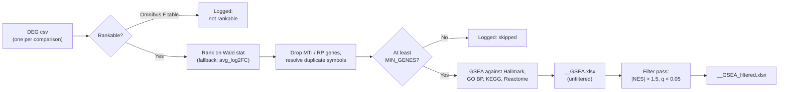

<div align="right">
  <small><em>Author: Saumya Pothukuchi & Claude AI - Opus 4.8 (Anthropic, 2026)</em></small>
</div>

# Pathway enrichment

* Differential expression ([10](10_differential_expression.md)) produced one table of genes per comparison. A list of several hundred genes is hard to read on its own; this page covers how script 09 (`scripts/09_pseudobulk_gsea.Rmd`) turns each table into **pathways**.
* The method is **gene set enrichment analysis (GSEA)**. It does not use a significance cut-off. Every tested gene is ranked, and the question is whether the members of a gene set sit unusually close to the top or the bottom of that ranking.
* Script 09 reads the DEG csv files written by script 08 directly, family by family, and writes one GSEA workbook per csv. Nothing in it is metacell-specific: it works on any table with a `gene` column and a ranking statistic.

| | Over-representation (e.g. `enrichGO` on significant genes) | GSEA (this pipeline) |
|:--|:--|:--|
| Input | Genes passing a p-value and fold-change cut-off | Every tested gene, ranked |
| Depends on an arbitrary cut-off | Yes | No |
| Detects many small, coordinated changes | Poorly | Yes |
| Direction | Needs separate up and down lists | One run: positive NES up, negative NES down |



## 1. How GSEA works

**Step by step, for one comparison and one gene set:**
1. Order all tested genes from most up-regulated to most down-regulated (section 2 covers what "most" means).
2. Walk down the list. Each time a gene in the set appears, a running score goes up; each time a gene outside it appears, the score goes down a little.
3. The **enrichment score** is the furthest the running score gets from zero. A set whose genes cluster near the top produces a large positive peak; near the bottom, a large negative one; spread evenly, the score stays near zero.
4. The score is compared with scores from many random gene sets of the same size to get a p-value, then corrected for the number of sets tested.
5. The **normalised enrichment score (NES)** rescales the score for gene set size, so sets of different sizes can be compared.


*Simulated: a gene set whose members (black ticks, middle) are concentrated near the top of the ranking (bottom). The running score (top) climbs steeply while members are dense and drifts down after them. The peak is the enrichment score.*

**The leading edge.**
* The members that appear before the peak are the **leading edge**: the genes driving the result. The `core_enrichment` column lists them.
* Two pathways with a significant NES but the same five leading-edge genes are one finding reported twice. Read this column before interpreting overlapping pathways as independent.

## 2. What to rank on

**The ranking statistic is the Wald statistic, not the fold change.**
* The Wald statistic is the fold change divided by its standard error: how large the change is, relative to how precisely it was measured.
* Ranking on fold change alone puts low-count genes at both ends of the list, because that is where the noisiest, largest fold changes are ([10](10_differential_expression.md)). The enrichment then follows those genes rather than the well-measured biology.


*Simulated: each dot is a gene, coloured by mean count. Red circles are the 40 genes with the largest fold change; most are low-count genes with small Wald statistics. Black squares are the 40 genes with the largest Wald statistic; they combine a clear change with enough counts to trust it.*

| Comparison family | Ranking column | Notes |
|:--|:--|:--|
| 1 to 3 (DESeq2) | `stat`, the unshrunken Wald statistic | Shrunken `avg_log2FC` is for volcano plots only |
| 4 per timepoint (`dream`) | `stat`, the moderated t | Same role as the Wald statistic |
| 4 omnibus | none | An F statistic has no direction, so it cannot be ranked |

* `RANK_COL` falls back to `avg_log2FC` if a table has no `stat` column, so a table from a different tool still runs. The column used is recorded in the manifest for every comparison.

## 3. Preparing the ranked list

**Duplicate gene symbols.**
* The enrichment step looks genes up by name. If one symbol appears twice, one entry overwrites the other, and which one survives depends on row order.
* The script keeps, for each symbol, the row with the largest absolute statistic before ranking:

```r
d %>% arrange(desc(abs(.data[[rank_col]]))) %>% distinct(gene, .keep_all = TRUE)
```

**Mitochondrial and ribosomal genes.**
* `GSEA_DROP_MT_RIBO <- TRUE` removes `MT-` and `RPS`/`RPL` genes from the ranking, matching how volcano plots are drawn in script 08. These genes move with cell size, stress and library depth, and pull translation and respiration sets to the top of many unrelated comparisons.

**Biotype flags.**
* `GSEA_DROP_FLAGGED <- FALSE` by default. Setting it to `TRUE` ranks only genes without a `remove_flag` (pseudogenes, lncRNAs, immunoglobulin and TCR genes, uncharacterised entries; [10](10_differential_expression.md)).
* Most gene sets contain few such genes, so the effect is usually small. It matters most for immune comparisons where immunoglobulin or TCR genes rank highly.

**Minimum list length.**
* A list shorter than `MIN_GENES` (200) is not tested. A very short list means the comparison had too few genes after filtering, and enrichment scores on it are unstable.

## 4. Gene sets

Four collections from MSigDB, loaded with `msigdbr` and tested together:

| Collection | What it holds | Strength | Caution |
|:--|:--|:--|:--|
| Hallmark | 50 curated, non-redundant programs | Easy to read, little overlap | Coarse |
| GO Biological Process | Several thousand process terms | Detailed | Very redundant; many terms share most of their genes |
| KEGG (legacy) | Metabolic and signalling pathways | Familiar pathway names | Legacy version, no longer updated |
| Reactome | Detailed reaction pathways | Mechanistic detail | Nested; parent and child pathways often both appear |

**Size limits.**
* `minGSSize = 15`: smaller sets give unstable enrichment scores, because a single gene moving changes the result.
* `maxGSSize = 500`: very large sets are so broad they are enriched in almost any ranked list.

**One correction across all collections.**
* All four collections are tested in one run, so multiple testing is corrected over all of them together. GO BP is by far the largest collection, so a Hallmark set carries the correction burden of several thousand GO terms.
* This is conservative. To report one collection on its own, rerun with only that collection in `term2gene`.

**Other settings.**
* `pvalueCutoff = 1`: nothing is filtered at run time, so the unfiltered result is always on disk and the threshold can be changed later without rerunning.
* `eps = 0`: very small p-values are estimated precisely rather than reported as a floor value.
* `seed = TRUE` and `set.seed(2024)`: the random gene sets used for p-values are the same on every run.

## 5. Every input accounted for

* Script 09 visits every DEG csv in every family folder and writes one manifest row for each, whatever happens to it:

| Status | Meaning | What to do |
|:--|:--|:--|
| `ok` | Tested and written | |
| `skipped` | Ranked list shorter than `MIN_GENES` | Check `n_genes_tested` in the DEG manifest |
| `not rankable` | Omnibus F table | Expected; nothing to do |
| `no result` | Ran, returned no gene sets | Usually a very short or very flat ranking |
| `no gene column` | Input table malformed | Check the csv |

* The number of rows equals the number of DEG csvs. This is what separates "looked, and it cannot be done" from "never ran", and it is the first thing to check when a result seems to be missing.

## 6. Filenames

Each GSEA file keeps its DEG file's name, with a suffix, in the matching family folder:

```
DEGs/within_condition_timepoint/<prefix>__<unit>__CTRL__T2_vs_T0.csv
GSEA/within_condition_timepoint/<prefix>__<unit>__CTRL__T2_vs_T0__GSEA.xlsx
GSEA/within_condition_timepoint/<prefix>__<unit>__CTRL__T2_vs_T0__GSEA_filtered.xlsx
```

* The label, comparison, timepoint and reference are parsed from the filename and written as columns into every result row, using the same parser as script 08. A GSEA row and the DEG table it came from therefore always carry identical identifiers.

## 7. Filtering

* A separate pass reads each finished workbook back and keeps sets with **|NES| > 1.5** and **q < 0.05**, writing `__GSEA_filtered.xlsx` next to the original.
* A filtered file is written even when nothing passes, so every unfiltered file has a partner. A missing filtered file always means something failed, never "no significant pathways".
* Because this pass reads files rather than the in-memory result, thresholds can be changed and the pass rerun on its own in seconds.

> [!TIP]
> `read.xlsx` returns `NULL` for a sheet with only a header row and drops columns that are entirely `NA`. Both break `bind_rows` when results are stacked. The `read_gsea()` helper handles both once, so the rest of the code does not have to.

## 8. Outputs

| File | Contents |
|:--|:--|
| `GSEA/<family>/<stem>__GSEA.xlsx` | All gene sets for one comparison, unfiltered |
| `GSEA/<family>/<stem>__GSEA_filtered.xlsx` | Sets passing the filter (may be empty) |
| `<prefix>_pseudobulk_GSEA_<family>.xlsx` | Every comparison in a family stacked, one sheet per label |
| `<prefix>_pseudobulk_GSEA_<family>_filtered.xlsx` | Same, filtered |
| `<prefix>_GSEA_run_manifest.xlsx` | One row per DEG csv, with status and ranking column |
| `<prefix>_GSEA_top_pathways_<family>.pdf` | Top `TOP_N` up and down sets with q < `Q_CUT`, one page per comparison |

## Reading a GSEA result

* **Start with Hallmark.** It gives an overview with little redundancy; GO and Reactome then add detail inside the programs Hallmark points to.
* **Group overlapping sets** by their leading-edge genes before counting how many pathways changed.
* **Check where the enrichment comes from.** A strong NES driven by a handful of genes is less robust than a moderate NES spread across many.
* **Read the comparison's standing first.** GSEA on a DEG table marked `exploratory` in the DEG manifest inherits that status.
