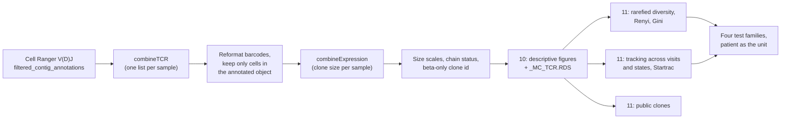
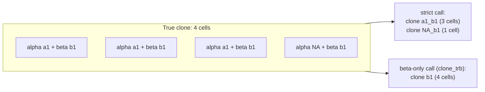

<div align="right">
  <small><em>Author: Saumya Pothukuchi & Claude AI - Opus 4.8 (Anthropic, 2026)</em></small>
</div>

# Clonal repertoire

* Every T cell carries a T cell receptor (TCR) assembled by random recombination of V, D and J gene segments. Cells that divide from one ancestor carry the same rearrangement, so a shared TCR sequence marks a **clone**.
* With paired 5' gene expression and V(D)J libraries, each cell has both a state label (from annotation, [07](07_annotation.md)) and a clone identity. This page covers how scripts 10 and 11 combine them:
  * **Script 10** (`scripts/10_clonal_repertoire.Rmd`) attaches the repertoire to the annotated object and produces the descriptive figures: clone sizes, where large clones sit, which states expanded clones occupy.
  * **Script 11** (`scripts/11_clonal_statistics.Rmd`) computes diversity, tracks clones across visits and states, and runs the tests. It reads only what script 10 wrote, never the raw contig files.
* Metacells play no part in clone calling. They supplied the state labels each cell carries; clonal statistics are computed on cells, with the patient as the replicate.
* Both scripts work for a BCR repertoire too (`VDJ_KIND <- "vdj_b"`); the reasoning below is written for TCR.



## 1. Calling clones

```r
CLONE_CALL <- "strict"
```

* **`strict`** defines a clone by the V and J genes plus the nucleotide CDR3 sequence, on both chains. Two cells share a clone only if their receptors are identical at the nucleotide level.
* Looser definitions (amino acid CDR3 only, or one chain only) merge receptors that were recombined independently but happen to encode the same protein. Within one patient that inflates clone sizes with cells that are not related by descent.
* Comparing receptors **across** patients is a different question (shared antigen specificity, not shared ancestry). It is handled separately as public clone detection (section 7), the only place the amino acid call (`CTaa`) is used.

**Contig settings.**
* `filterMulti = TRUE`: a barcode with more than one contig for a chain keeps the highest-UMI contig, instead of being discarded. Real doublets were already removed by the dual-TRB filter in step 01 ([03](03_preprocessing.md)).
* `removeNA = FALSE`: barcodes with only one chain are kept. A single-chain cell is still a clone, and dropping these cells biases recovery towards high-expressing cells.

## 2. Matching contigs to cells

**Barcode format.**
* `combineTCR` writes barcodes as `SAMPLE_BARCODE`; step 01 named cells `BARCODE_SAMPLE`. They are reconciled before joining:

```r
d$barcode <- sub("^(.*?)_(.*)$", "\\2_\\1", d$barcode)
```

* The script reports matched barcodes per sample. **A sample dropping to zero matches means this reformat is wrong**, not that V(D)J failed for that sample.

**Keep only cells in the object.**
* The contig files include barcodes that never reached the annotated object: cells that failed QC, doublets, outliers, and cells that belong to another lineage subset.
* Contigs are filtered to the object's cells **before** clone sizes are computed. Otherwise clone sizes describe the raw contig file, and their denominators no longer match the cell counts in every other table.

**Recovery.**
* Not every cell gets a TCR. 10x V(D)J recovery is typically 75 to 90% of T cells: cells with little TCR mRNA fail contig assembly, and innate-like cells may make no productive TCR at all.
* Recovery is printed per sample. One sample far below the others usually points to a V(D)J library problem or a library-to-sample mapping error, not to biology. The resolved library-to-sample table is printed for exactly this reason: a token matching the wrong folder raises no error.

## 3. Chain dropout

**The problem.**
* A `strict` clone string joins both chains. If one cell of a clone lost its alpha chain in capture, its string differs from its sister cells' and it is counted as a separate clone.



* Dropout therefore inflates the number of clones, shrinks the largest clones, lowers clonality and under-detects clones persisting across visits. The rate can differ several-fold between samples, so it can create apparent differences between samples.

**What the scripts do.**
* Script 10 records `chain_status` per cell (`paired`, `beta_only`, `alpha_only`) and a beta-only clone id, `clone_trb`, built from the beta V and J genes and the beta nucleotide CDR3.
* Script 11 repeats the key diversity and overlap metrics on `clone_trb` as a **sensitivity analysis**. A conclusion that holds on both clone definitions does not depend on dropout.
* Beta-only cells are **not** merged into their paired relatives in the main analysis. Two clones can share a beta chain, so merging would invent relationships the data do not show.
* Samples with more than `DROPOUT_FLAG_PCT` (10%) cells lacking an alpha chain are flagged.

## 4. Clone size: three scales

* Script 10 attaches clone frequency **within each sample** (`group.by = "none"`), and checks the claim rather than trusting the argument:

```r
cat("clonalFrequency is per-sample:", all(.chk$n_in_sample == .chk$clonalFrequency))
```

* Patient-level frequency, pooled over visits, is computed separately (`patient_clone_n`). It is the right denominator for following a clone across visits; the per-sample value is right for statements about one timepoint.

**Expanded or unique.**
* A clone seen in 2 or more cells of a sample is **expanded**; seen once, **unique**.
* The one size statement that needs no chosen cut-off.

**Count bins.**
* Absolute cells per clone: 1, 2, 3 to 5, 6 to 20, more than 20. Tuned for blood, where a 20-cell clone is already large.
* **Not comparable across samples of different depth.** A clone of 30 cells is 3% of a 1,000-cell sample and 0.3% of a 10,000-cell sample; both land in the same bin.

**Occurrence bins.**
* Each clone's share of its own sample's repertoire, as a percentage ([Mhanna et al. 2024](https://doi.org/10.1016/j.crmeth.2024.100738)). A clone at 2% of the repertoire is at 2% however many cells were sequenced.
* This is the scale for comparing samples.


*Simulated: one repertoire sampled at 1,000 and 10,000 TCR+ cells. By count bins, the deeper sample appears far more expanded (59% against 42% of cells in clones over 20 cells). By occurrence bins, the two agree closely.*

> [!NOTE]
> Occurrence bins have a floor. The smallest share a clone can have is one cell, so in a 1,000-cell sample every singleton sits at 0.1%, and in a 10,000-cell sample at 0.01%. The lowest occupied bin therefore still depends on depth. Compare expanded clones on this scale, and do not read differences in the lowest bins between samples of very different depth as biology.

**Rank-abundance.**
* Clone rank against clone frequency, on log-log axes. A steep head means a few clones dominate.
* It uses no bins at all. When a binned figure and the rank-abundance curve seem to disagree, the curve is the more reliable of the two.

## 5. Diversity

### Rarefaction

**Every diversity measure depends on depth.**
* Sequencing more cells finds more clones, so a deeper sample looks more diverse even if its repertoire is identical. No diversity index is immune to this.
* Script 11 therefore **rarefies**: it repeatedly draws the same number of TCR+ cells from every sample and computes each metric on the draws, averaging over `N_BOOTS` (100) repeats.

```r
MIN_VDJ_CELLS <- 750   # below this, no diversity estimate
RAREFY_TO     <- 600   # NA means the smallest retained sample
```


*Simulated: four samples of very different depth. At full depth, sample 4 (8,000 cells) has the most clones. Drawn down to 600 cells each, it has the fewest, because a few expanded clones take a large share of its repertoire. The ordering reverses once depth is equal.*

**Choosing the two numbers.**
* `MIN_VDJ_CELLS`: samples with fewer TCR+ cells get no diversity estimate. They are reported, not silently dropped. Raising it gives tighter estimates and fewer samples.
* `RAREFY_TO`: the common depth. It should sit at or below the smallest retained sample, and below `MIN_VDJ_CELLS` so even the smallest retained sample gets real random draws rather than the same cells every time.
* Setting `RAREFY_TO <- NA` uses the smallest retained sample automatically. It is convenient, but lets one shallow sample set the resolution for every other; an explicit value keeps that decision visible.
* The rarefaction curves are drawn so the choice can be justified from the data rather than from a bare threshold.

### The metrics

| Metric | Most sensitive to | Reads as |
|:--|:--|:--|
| Richness | Number of distinct clones | How many clones |
| Shannon entropy | The typical clone | Overall diversity |
| Inverse Simpson | Large clones | Effective number of dominant clones |
| Berger-Parker | The single largest clone | How dominant the top clone is |
| Gini coefficient | Inequality of clone sizes | 0: all clones equal; 1: one clone holds everything |

* Chao1 is not computed. On TCR data dominated by singletons it was unstable between rarefactions, and because it shares a correction family with the other metrics, its noise also weakened every other metric's adjusted p-value.

### Renyi profiles

* Richness, Shannon, inverse Simpson and Berger-Parker are four points on one curve, the **Renyi entropy profile**, indexed by an order alpha:
  * alpha = 0: richness (every clone counts equally).
  * alpha = 1: Shannon.
  * alpha = 2: inverse Simpson.
  * alpha to infinity: Berger-Parker (only the largest clone counts).
* Moving right along the curve gives large clones more and more weight.


*Simulated: repertoire 1 has many rare clones plus one clone holding a quarter of all cells; repertoire 2 has fewer clones of equal size. Repertoire 1 is more diverse by richness and less diverse by every index that weights large clones. Neither is "more diverse" in general.*

* Plotting the whole profile shows whether a difference is about richness, the typical clone or the dominant clone, and avoids an argument about which single index was chosen.
* When two profiles cross, no single diversity index can rank the repertoires. That is worth knowing before reporting one.
* Script 11 tests the profile at every alpha, with the same patient-level tests as the other metrics.

## 6. Tracking clones

### Across visits, within a patient

* Overlap is computed between pairs of visits **of the same patient** only.
* **Morisita** is the index to report. It weights clones by size, so it measures whether the same dominant clones are present at both visits.
* **Jaccard** counts distinct clones shared, regardless of size. Because most clones are singletons seen once, it is close to zero even when every large clone persists.


*Simulated: two visits of one patient. All 25 large clones are present at both visits (on the diagonal), while 2,000 singletons are each seen at only one visit (along the axes). Jaccard reads 0.03; Morisita reads 0.76. The biplot shows why.*

* The **clone-count biplot** shows each clone as a point: cells at visit 1 against cells at visit 2. Clones on the diagonal persisted at similar size; clones along one axis were seen at one visit only.
* A clone seen at 2 or more visits of a patient is **persistent**. A patient with only one sequenced visit has persistence undefined, not 0%, and is flagged in every table.
* Top clone trajectories per patient show expansion and contraction of individual clones over time.

### Between states

* A clone found in two states links them: cells of one ancestor now sit in both.
* Sharing is measured with the **Tversky index** in its asymmetric form: the fraction of state A's clones also found in state B.
* Asymmetry is the point. A small effector state can have almost all of its clones in a large memory state without the reverse being true; a symmetric index averages that away.
* The result is one square heatmap, rows and columns ordered by clustering, with the diagonal masked.

### Startrac

* `StartracDiversity` summarises three properties per state and patient: **expa** (clonal expansion within the state), **migr** (clones spread across timepoints) and **tran** (clones shared with other states).
* It reads the object's active identities. Script 10 sets them to the state label before saving; left unset, Startrac reports one state called `SeuratProject` and `tran = 0` everywhere.

## 7. Public clones

* A **public** clone has the same amino acid CDR3 in two or more patients. Shared amino acid receptors across people can reflect a common antigen.
* They can also be an artefact. If two libraries were sequenced together, a small fraction of reads can be assigned to the wrong sample (index hopping), creating apparent sharing.
* Script 11 records the sequencing batch of each public clone. **Sharing confined to patients from one batch is more likely to be an artefact**; sharing across batches is harder to explain that way.

## 8. Testing: the patient is the unit

* Every metric is first reduced to **one number per sample**, then tested with the patient as the replicate, using the same four families as differential expression ([10](10_differential_expression.md)):

| Family | Comparison | Test |
|:--|:--|:--|
| 1 | CASE vs CTRL, patients | Wilcoxon on per-patient means, with an effect size |
| 2 | Timepoints within a condition | Mixed model, patient random intercept |
| 3 | CASE vs CTRL at each timepoint | Wilcoxon |
| 4 | Condition by timepoint | Mixed model with the interaction term |

* Pooling clones across patients (as some published analyses do for sharing or inequality panels) lets the patient with the most cells set the answer. With few patients and uneven visit numbers, this pipeline keeps the patient as the unit throughout.

**When a test cannot succeed.**
* With small groups, a rank test has a smallest possible p-value set by the group sizes alone.
* *Worked example:* with 3 patients per arm there are 20 ways to split 6 patients into two groups of 3, and only 2 of them (perfect separation in either direction) are as extreme as possible. The smallest two-sided p-value is 2/20 = 0.10. The test cannot reach 0.05 however large the effect.
* Family 1 is therefore reported with an effect size (rank-biserial correlation), the smallest attainable p, and a `powered` flag that is `FALSE` when 0.05 is out of reach.
* Family 1 is also rerun excluding patients with a single sequenced visit (`multi_visit_only`), so a result carried by those patients' one sample is visible.

## 9. Carrying external per-cell calls

* Scripts 10 and 12 (`scripts/12_external_label_mapping.Rmd`) can transfer per-cell calls made outside this pipeline (for example a flag from a separate gating or classifier tool) onto the annotated object, matched by barcode after the same `SAMPLE_BARCODE` to `BARCODE_SAMPLE` reformat.
* The transferred call is added as a **new** column. `cluster_label`, `cell_label` and `mc_state` are never overwritten, so the object remains reproducible from the annotation scripts alone.
* Matched and unmatched counts are printed before and after transfer. Flag-positive cells are then summarised per label, per sample and against clone size.

## 10. Outputs

| File | Written by | Contents |
|:--|:--|:--|
| `<prefix>_MC_TCR.RDS` | 10 | Annotated object with clone ids, sizes, chain status and bins attached |
| `<prefix>_clonal_TCR.xlsx` | 10 | Recovery, dropout, clone sizes per sample and state, top clones |
| `<prefix>_clonal_TCR_stats.xlsx` | 11 | Rarefied diversity, Renyi, overlap and persistence, Tversky, Startrac, public clones, test families, manifest |
| `clonal/` PDFs | 10, 11 | One file per figure group |

## Before trusting a clonal result

| Check | Expected |
|:--|:--|
| Barcodes matched per sample | No sample at or near zero |
| V(D)J recovery | 75 to 90%, no sample far below the rest |
| `clonalFrequency is per-sample` | `TRUE` |
| Alpha dropout per sample | Below `DROPOUT_FLAG_PCT`, or the `clone_trb` sensitivity analysis agrees |
| Samples below `MIN_VDJ_CELLS` | Listed and accounted for |
| Renyi profiles | Checked for crossing before a single index is reported |
| Public clones | Not confined to one sequencing batch |
| Family 1 `powered` | `TRUE`, or the result reported as an effect size only |
