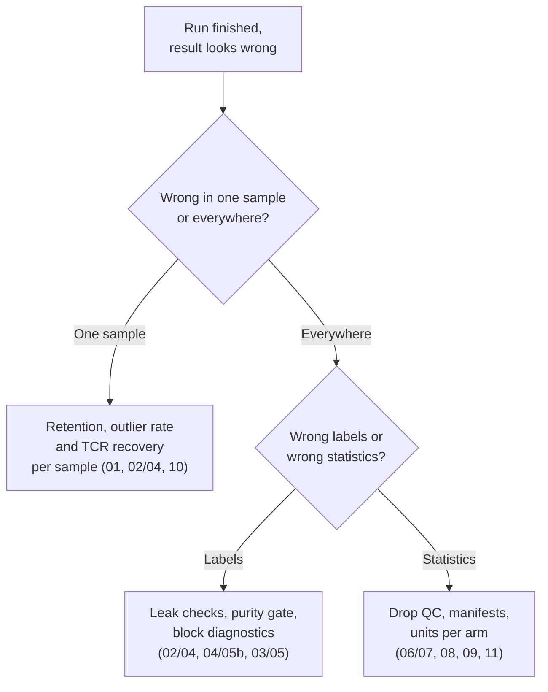

<div align="right">
  <small><em>Author: Saumya Pothukuchi & Claude AI - Opus 4.8 (Anthropic, 2026)</em></small>
</div>

# Reading the diagnostics

* Every script prints checks as it runs, and most of the serious mistakes in this pipeline are **silent**: the run finishes, the figures look normal, and the error only shows in one of these printouts.
* This page collects every check in one place, step by step: what is printed, what a healthy value looks like, what an unhealthy one usually means, and what to change.
* Use it in two ways:
  * **While running a step**, read that step's section before moving on.
  * **When a finished run looks wrong**, start from the symptom table below and work back to the step that caused it.
* Several checks are `stopifnot()` assertions: the script stops rather than continuing with a wrong result. A stopped script is the pipeline working as intended; the message says which assumption failed.

## Start from the symptom

| Symptom | Most likely cause | Go to |
|:--|:--|:--|
| One sample looks different from all others in every figure | Sample-level QC or batch issue | [Step 01](#step-01-preprocessing), [Steps 02 and 04](#steps-02-and-04-building-metacells) |
| Proliferation, stress or sex genes drive the module heatmap | Lateral list not applied | [Lateral leak check](#steps-02-and-04-building-metacells) |
| A subset contains another lineage's modules | Wrong block label or loose purity gate | [Purity gate](#step-04-or-05b-the-handover) |
| A subset metacell group looks like one clone | TCR V/J segments not lateral | [TCR check](#steps-02-and-04-building-metacells) |
| Many `Undefined` blocks | Thresholds too strict, or markers missing | [Steps 03, 05 and 05b](#steps-03-05-and-05b-annotation) |
| Proportions differ between conditions for every label | Uneven drop rate | [Steps 06 and 07](#steps-06-and-07-composition) |
| A DE or GSEA result is missing | Guard fired | [Steps 08 and 09](#steps-08-and-09-differential-expression-and-gsea) |
| A sample has no clones | Barcode format or library mapping | [Steps 10 and 11](#steps-10-and-11-clonal) |



## Step 01: preprocessing

| Printed | Healthy | If not |
|:--|:--|:--|
| Duplicated genes after merge | An empty vector per sample | The merge did not collapse duplicates. Stop: every gene total downstream is wrong ([03](03_preprocessing.md)). |
| TCR recovery % | 75 to 90 | One low sample: check its V(D)J library resolved to the right folder. All low: check the chemistry. |
| Dual-TRB barcodes, raw against supported | Supported well below raw | Equal: the ambient filter is not acting; check `min_second_beta_umis`. |
| TCR doublets removed | Well under the 10x expected multiplet rate | Above it: the filter is over-calling; raise `min_second_beta_frac`. |
| Retention % per sample | Similar across samples | See below. |

* **Retention is the first per-sample check.** Every proportion downstream inherits any difference in how many cells each sample lost.
* Before calling a low-retention sample a technical problem, compare it with `n_cells_loaded` and its T cell share: the TCR doublet rate rises with both.

## Steps 02 and 04: building metacells

**Cells and genes retained.**

```
Cells: 254,331 -> 251,570 (98.91%)
Genes: 33,344 -> 33,331 (99.96%)
```

* High 90s is normal. A large drop means `max_excluded_gene_fraction` is too strict, or a sample has many damaged cells.

**Attrition per sample.**
* One row per sample, one column per filter. Read along rows: a sample losing far more than the others at one filter identifies both the sample and the reason.


*Simulated. Left: one sample retains 91% of cells where the others retain about 98.5%; that sample needs an explanation before its proportions are trusted. Right: one sample has 15% of cells left as outliers on a subset, above the 10% guide.*

**Lateral leak check.**

```
Lateral genes that leaked into selection (should be empty): []
```

* Anything printed means lateral marking did not take effect, usually because it was applied to the wrong object or after feature selection. Fix and rerun; do not continue ([05](05_gene_lists.md)).

**TCR V/J check (subset only).**
* Prints any selected gene matching `TR[ABGD][VJD]`. On a lineage subset, anything here means clone identity is driving which cells pool together. Stop.

**Selected feature genes.**
* A few thousand globally, fewer on a subset. Below about 200 on a subset there is too little signal to build good metacells. The usual causes are a purity gate that removed too much, or a lateral list covering informative genes.

**Outlier rate.**

```
Metacells: 6,367 | outlier cells: 12,841 (5.05%)
```

* 5 to 10% is normal, and a rise on a subset is expected. Above about 10% on a subset suggests `target_metacell_size` is too large for the structure left ([06](06_parameters.md)).
* A single sample with a much higher rate than the others is either a quality problem or a population present only in that sample with too few cells to form metacells.

**Realized graining.**
* `mean cells per metacell` on a subset run. Compare with the 10 to 50 range ([06](06_parameters.md)); the target is a guide, the realized value is what counts.

**Rare gene cap.**

```
candidate rare genes: 312 (cap is 500)
```

* Under 500: no concern. At 500: contaminant genes may be filling the detector's slots and hiding a real rare population ([04](04_building_metacells.md)).
* **Rare modules made of another lineage's genes** on a subset mean foreign cells passed the purity gate. The script tabulates rare modules against global block and label so they can be traced.

## Step 04 or 05b: the handover

These checks run whichever subset approach is used ([08b](08b_rerun_or_reuse.md)). Script 04 prints them in Python before rebuilding metacells; script 05b prints the same tables in R before re-blocking the global metacells.

**Flagged global blocks.**

```
cells in flagged blocks: 1,204 (0.47% of clean cells)
```

* Blocks within `margin_thresh` of a second lineage call, or `Undefined`, are listed with their marker panel means. At a fraction of a percent of cells, the question is academic and the default subset is fine.

**Purity gate: worst foreign score in the lineage's blocks.**
* Printed at several percentiles. Clean metacells sit low and flat; contaminated ones rise sharply at the top. Set `purity_other_max` in the gap ([08](08_two_passes.md)).

**Purity gate: failure rate per block.**
* **Diffuse** (a few percent across many blocks): stray metacells, which is what the gate is for.
* **Concentrated** (one block failing at 80%): that block's label is wrong. Fix it with `BLOCK_RELABEL` and in script 03, rather than letting the gate remove most of a block.

**Purity gate: mean panel of dropped metacells.**
* Dropped metacells should look foreign (high on another lineage's panel). Low on everything, including their own lineage, means the floor (`purity_min`) is too high and shallow, real metacells are being lost.

**Cells kept.**
* Label alone against label plus gate. A drop of a few percent is typical.

**Stale fields (script 04 only).**
* After stripping, no column should carry an MC2 name without the `global_` prefix. Script 05b builds a fresh object, so it has none to strip.

## Steps 03, 05: annotation

**`range(x)`.**
* The span of `log10(mean)` across genes. Read it before setting `inVarMean_MeanThresh`; it moves between the global object and every subset ([06](06_parameters.md)).

**Threshold sweep.**
* Genes selected at each `inVarMean_varmeanThresh`. Pick the value near the target (about 2,000 before removing lateral and noisy genes). Script 05b can pick it automatically from `TARGET_N_HVG`.

**Module HVGs after lateral and noisy removal.**

```
module HVGs: 2,134 -> 1,981 after dropping 153 lateral/noisy
```

* A larger drop on a subset than globally is expected (TCR V/J and ribosomal genes rank higher once lineage differences are gone). Fewer than 200 left stops the script.

**Metacells available for correlation.**
* Gene modules are built from correlations across metacells, so their stability depends on how many metacells there are. Below about 200, lower `NCLUST` ([06](06_parameters.md)). On the reuse path this number is smaller than on the rerun path for the same lineage ([08b](08b_rerun_or_reuse.md)).

**Module size distribution.**

```r
table(cut(table(res2_cut), breaks = c(0,1,3,5,10,20,Inf)))
```

* Many modules of 1 to 3 genes means `NCLUST` is too high. Drop to 60 to 80.

**Blocks with fewer than 10 metacells.**
* Scores on very small blocks are unstable. If several appear, lower the block count and redraw.

**`max(abs(gz)) < 10` (asserted).**
* A per-gene z above 10 means a spread estimate collapsed, which happens when a gene is expressed in only one or two blocks.

**Per-block diagnostic table.**
* Call, best score, margin to the second call, and the lineage check value (CD3 globally, T core or lineage core on a subset). Read low-margin and `Undefined` blocks against their top modules ([07](07_annotation.md)).

**Metacell accounting.**

```
Metacells in module heatmap (thmz):  6,367
Metacells assigned to >=1 cell:      6,367
Cells total:                       251,570
  in metacell:                     238,729
  MC2 outliers:                     12,841
  Unassigned (MC not in heatmap):        0
```

* `Unassigned` must be 0. Anything else means metacells were lost between the metacell object and the heatmap matrix, and the annotation is incomplete in a way nothing later will flag.

**Global label table (subset only).**
* `table(global_broad_label)` on the subset. Every cell should carry the lineage that was subset.

## Steps 06 and 07: composition

| Printed | Healthy | If not |
|:--|:--|:--|
| Drop rate per sample and condition | Similar across conditions | Proportions differ between conditions for this reason alone ([09](09_composition.md)) |
| Percentages add to 100 | Asserted | `complete()` did not add the zeros |
| Structural zeros | A small share of the table | The label set is too fine; merge labels |
| CLR values sum to 0 per sample | Asserted | The transform was applied to the wrong axis |
| Usable timepoints per condition | The timepoints you expect | Too few patients at a timepoint; it is excluded from that condition's model |
| `model` column | `lmer` where patients repeat | `lm` means no repeated sampling for that label |

## Steps 08 and 09: differential expression and GSEA

**DEG run manifest** (`<prefix>_DEG_run_manifest.xlsx`), the most useful single sheet:
* `skipped` rows and which comparison they were.
* `exploratory` rows, resting on fewer than 3 units in one arm.
* `n_test` and `n_ref` matching the intended design.
* `n_genes_tested` in the thousands. Low hundreds means the units were built from too few cells.

**Interaction timepoints.**

```
Timepoints in the interaction model: T0, T1, T2 | reference: T0
```

* Only timepoints with enough patients in both arms enter. A missing timepoint here is a design limit, not an error.

**GSEA run manifest** (`<prefix>_GSEA_run_manifest.xlsx`):
* One row per DEG csv. Row count should equal the number of DEG csvs; a mismatch is the first place to look when a result is missing.
* `not rankable` for omnibus tables is expected. `skipped` traces back to a short gene list in the DEG manifest.

## Steps 10 and 11: clonal

| Printed | Healthy | If not |
|:--|:--|:--|
| Resolved library-to-sample table | Each library maps to the sample you expect | A token matched the wrong folder; fix `config/vdj_library_map.csv` |
| Barcodes matched per sample | No sample at or near 0 | The barcode reformat is wrong, not V(D)J ([12](12_clonal.md)) |
| V(D)J recovery per sample | 75 to 90% | Library problem in that sample |
| `clonalFrequency is per-sample` | `TRUE` | `group.by` did not take; every expansion statement is at the wrong level |
| Alpha dropout per sample | Below `DROPOUT_FLAG_PCT` | Paired-chain clone calls are biased; check the `clone_trb` sensitivity results |
| Samples below `MIN_VDJ_CELLS` | Few | If most are below, lower it and accept wider intervals rather than analysing three samples |
| Startrac major clusters | The state labels | `SeuratProject` means identities were not set |
| Public clones in one batch | Few | Possible index hopping between libraries sequenced together |
| `powered` flag | `TRUE` | The condition comparison cannot reach significance with these group sizes; report the effect size |
