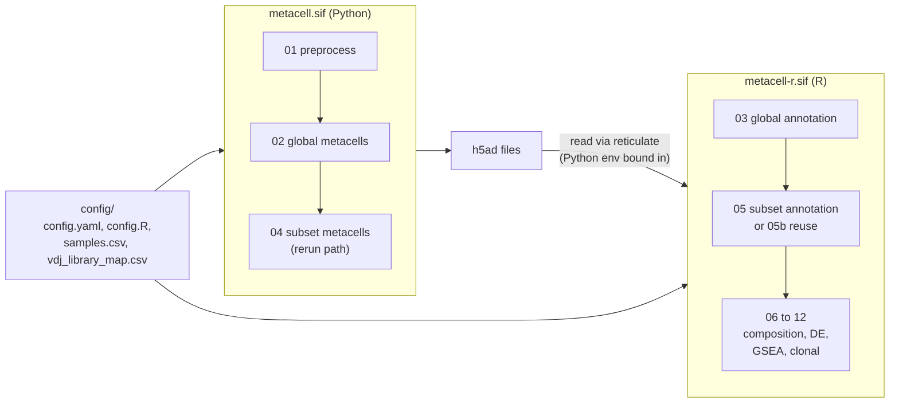

<div align="right">
  <small><em>Author: Saumya Pothukuchi & Claude AI - Opus 4.8 (Anthropic, 2026)</em></small>
</div>

# Reproducibility

* A metacell analysis passes through two languages, several dozen packages, random steps in MC2 and in heatmap clustering, and many hand-set thresholds. Any of these can change a result between two runs that look identical.
* This page covers what the repository does so that a run can be repeated exactly, and audited afterwards:
  * **Environments:** a Python image and an R image, each built from a file in `env/`.
  * **Configuration:** paths, sample design and tunables kept in `config/`, never inside scripts.
  * **Seeds:** fixed for every random step.
  * **Records:** what each container holds, and what each run printed.
* It also lists what the repository does **not** pin, which belongs in a methods section instead.



## 1. Two environments, on purpose

* Steps 01, 02 and 04 run in Python (MC2, scanpy, anndata). Steps 03, 05, 05b and 06 to 12 run in R (Seurat, DESeq2, scRepertoire and others).
* They are kept in **separate images** because their system libraries sometimes conflict, and because an R package update should never invalidate the image MC2 metacells were built in.
* The two meet in one place: steps 03, 05 and 05b read `.h5ad` files through `reticulate` and the `anndata` R package, which call the Python environment. This is handled by binding the Python environment into the R container at run time (section 4), not by installing conda twice.

## 2. Python

* `env/metacell.yml` is a full conda export, including build strings. That makes it exact, and also specific to Linux x86-64.
* The container is built **from the same file**, so a local environment and the image cannot drift apart.

```bash
mamba env create -f env/metacell.yml && conda activate metacell
```

| Package | Version |
|:--|:--|
| Python | 3.10 |
| metacells | 0.9.5 |
| scanpy | 1.10.4 |
| anndata | 0.10.9 |
| numpy | 2.2.x |

> [!WARNING]
> The export pins numpy twice: `numpy-base=2.2.5` from conda and `numpy==2.2.6` from pip. Pip wins at install time and the result works, but a pip package overwriting a conda one can break a later solve. Resolve it to one source before building an image intended for citation.

**Threads.**
* MC2 sets its own worker count from the scheduler (`LSB_DJOB_NUMPROC` on LSF, otherwise the CPU count; [04](04_building_metacells.md)).
* The image sets `OMP_NUM_THREADS`, `OPENBLAS_NUM_THREADS` and `MKL_NUM_THREADS` to 1, so numerical libraries do not start their own threads on top of MC2's workers and overload the node.

## 3. R

* `env/metacell-r.def` builds on `rocker/r-ver:4.4.2`.
* **CRAN is pinned by date**, using a Posit Package Manager snapshot written into `Rprofile.site`:

```r
options(repos = c(CRAN = "https://packagemanager.posit.co/cran/2025-01-15"))
```

* One line decides which version of every CRAN package is installed. It is easier to reason about, and to move forward on purpose, than a list of individually pinned versions.
* **Bioconductor is pinned by release** (3.20), which fixes its own package set.
* One package comes from GitHub (`SCpubr`), which is not pinned by either mechanism.

**Version assertions.** Two requirements are checked at the top of the scripts that depend on them, and in the image's self-test:

```r
stopifnot(packageVersion("Seurat") >= "5.0.0")
stopifnot(packageVersion("scRepertoire") >= "2.0.0")
```

* Seurat v5 stores counts in layers, and scRepertoire 1.x and 2.x differ enough that steps 10 and 11 do not run on 1.x. Failing at the first line is better than failing halfway through a long run.

## 4. Containers

**Building.**

```bash
apptainer build env/metacell.sif env/metacell.def
apptainer build env/metacell-r.sif env/metacell-r.def
```

* Building needs root or fakeroot, which most clusters allow on login nodes or CI runners but not on compute nodes.
* If the images are pushed to a registry, `apptainer pull oras://<registry>/<image>:<tag>` replaces building on the cluster.

**Running.**

```bash
apptainer exec --bind "$PWD":"$PWD" --pwd "$PWD" env/metacell.sif python3 scripts/01_preprocess.py
```

```bash
apptainer exec --bind "$PWD":"$PWD" --bind /path/to/envs/metacell:/opt/pyenv --pwd "$PWD" --env RETICULATE_PYTHON=/opt/pyenv/bin/python env/metacell-r.sif Rscript -e 'rmarkdown::render("scripts/03_global_modules_annotation.Rmd")'
```

* `--bind "$PWD":"$PWD" --pwd "$PWD"` makes paths identical inside and outside the container, which is what lets `config/config.yaml` and `config/config.R` work unchanged either way.
* The second `--bind` and `RETICULATE_PYTHON` point the R image at the Python environment for steps that read `.h5ad` files.

**Auditing.** Each image records its contents at build time, so a container can be checked without running it:

| Image | Record |
|:--|:--|
| `metacell.sif` | `/opt/metacell.lock` (conda explicit list), `/opt/metacell.pip.txt` (pip freeze) |
| `metacell-r.sif` | `/opt/r-packages.csv` (every installed package and version) |

## 5. Configuration lives in `config/`

* No sample IDs and no absolute paths appear in `scripts/`. Four files describe a study:

| File | Read by | Holds |
|:--|:--|:--|
| `config/samples.csv` | All steps | One row per sample: patient, timepoint, condition, plotting label |
| `config/vdj_library_map.csv` | 01, 10 | V(D)J library folder token to sample ID |
| `config/config.yaml` | Python steps, and 05b | Paths and every MC2 tunable, including subset purity thresholds |
| `config/config.R` | R steps | The same paths, factor levels, palettes and `drop_labels` |

* A parameter set in one place cannot disagree with itself between steps. The subset purity thresholds are an example: script 04 (Python) and script 05b (R) both read them from `config.yaml`, so the rerun and reuse paths gate on identical values ([08b](08b_rerun_or_reuse.md)).
* Parameters tuned while reading a diagnostic (HVG thresholds, `NCLUST`, block count, signatures) stay at the top of the script that prints the diagnostic ([06](06_parameters.md)).

## 6. Seeds

| Step | Seed | What it fixes |
|:--|:--|:--|
| 02, 04 | `random_seed: 123` in `config.yaml`, passed to every MC2 call | Preliminary piles, feature selection sampling, metacell partition |
| 03, 05, 05b | `set.seed(42)` before the module heatmap | k-means split of metacells into blocks, and therefore block numbers |
| 09 | `set.seed(2024)`, `seed = TRUE` | Random gene sets used for GSEA p-values |
| 10, 11 | `set.seed(123)` | Rarefaction draws and bootstraps |

* Seeds make a rerun on the same input reproduce exactly. They do **not** make a result robust.
* A useful check before reporting: change a seed and rerun. A conclusion that changes with the seed was never supported by the data; the seed was hiding the instability.
* Block numbers depend on the heatmap seed. Manual overrides keyed on block numbers (`BLOCK_RELABEL`, `BLOCK_STATE_OVERRIDE`) are only valid for the run that produced them.

## 7. What is not pinned

These are outside the repository and belong in the methods section:

| Item | Why it matters |
|:--|:--|
| Cell Ranger version and reference | Gene models, gene symbols and the duplicate symbols handled in step 01 ([03](03_preprocessing.md)) |
| GENCODE release for biotype annotation | Which genes get `remove_flag` in step 08 |
| MSigDB version (whatever `msigdbr` ships) | Gene set membership in step 09 |
| `SCpubr` (GitHub) | Plot styling only |
| Manual curation | `BLOCK_RELABEL`, `MC_RELABEL`, `BLOCK_STATE_OVERRIDE` entries and the reason for each |

## 8. Session records

* Every Rmd prints package versions near the top, and the knitted HTML carries them along with every diagnostic the run printed.
* Keeping the knitted HTML next to the outputs is the simplest provenance record available: it states what ran, with which versions, and what it printed.
* For the Python steps, keep the executed notebook (with outputs) for the same reason.

## Checklist for a reportable run

| Item | Where it is recorded |
|:--|:--|
| Image versions | `/opt/metacell.lock`, `/opt/r-packages.csv` |
| Config used | `config/` at the commit that ran |
| Seeds | `config.yaml`, script headers |
| Subset approach (rerun or reuse) and its parameters | Script 04 or 05b header, workbook |
| Manual overrides and reasons | Script comments, `manual_relabels` sheet, `manual_override` column |
| Every printed diagnostic | Knitted HTML and executed notebooks |
