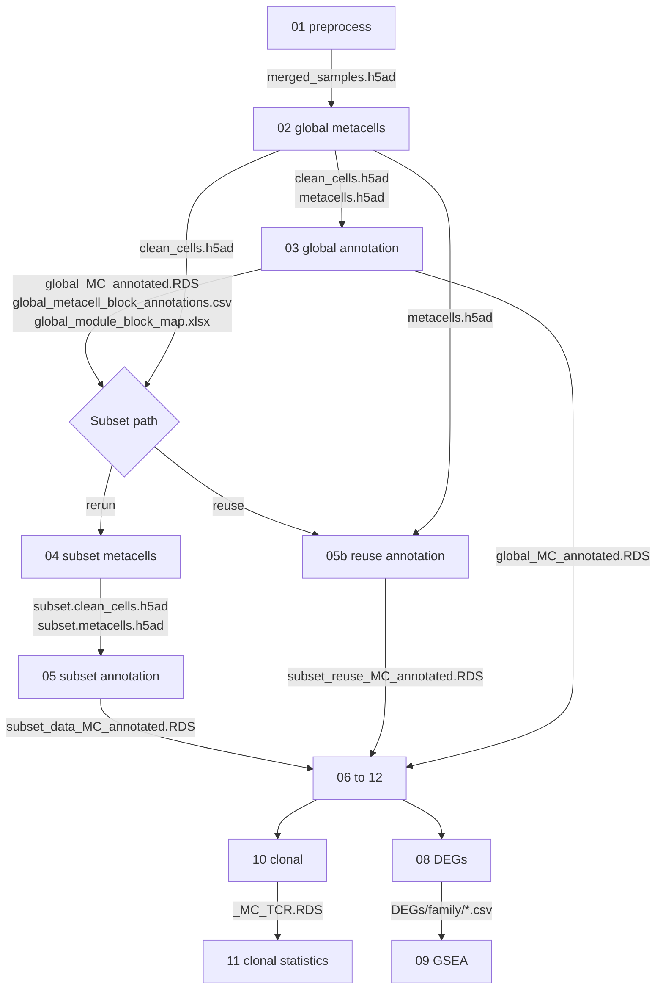

<div align="right">
  <small><em>Author: Saumya Pothukuchi & Claude AI - Opus 4.8 (Anthropic, 2026)</em></small>
</div>

# Outputs

* Every step reads what an earlier step wrote. This page is the map: what each step writes, where it lands, and which step reads it next.
* Use it when a script stops because a file is missing, when deciding which steps to rerun after a change, or when looking for a specific table.
* Two naming variables appear throughout:
  * **`<slug>`** is the analysis folder: `global`, `subset` (rerun path) or `subset_reuse` (reuse path, [08b](08b_rerun_or_reuse.md)). Set per run so the global run and every subset run sit side by side without overwriting each other.
  * **`<prefix>`** is `FILE_PREFIX`, set in each script's configuration chunk: `global`, `subset_data` or `subset_reuse` by default.
* For more than one lineage, give each its own slug and prefix (for example `tcell`, `myeloid`) in scripts 04/05 or 05b and in the `LEVEL` switch of steps 06 to 09.

## Folder layout

Everything is written under `results/`, created as needed:

```
results/
  h5ad/<slug>/metacell/          AnnData objects               01, 02, 04
  rds/<slug>/metacell/           Seurat objects, intermediates  03, 05, 05b, 10
  csvs/<slug>/metacell/          tables and workbooks           03 to 12
    DEGs/<family>/               one csv per comparison         08
    GSEA/<family>/               one xlsx per DEG csv           09
    clonal/                      repertoire tables              10, 11
  csvs/global/qc/metacell/       QC workbooks                   01, 02, 04
  pdfs/<slug>/metacell/          figures                        03 to 12
```

## How files flow between steps



## Objects

| File | Written by | Read by | Contents |
|:--|:--|:--|:--|
| `project.merged_samples.h5ad` | 01 | 02 | All samples, duplicate genes collapsed, TCR doublets removed, design attached |
| `project.clean_cells.h5ad` | 02 | 03, 04, 05b | Clean cells with `metacell` / `metacell_name`, plus the `lateral_gene`, `noisy_gene` and `rare_gene` masks |
| `project.metacells.h5ad` | 02 | 03, 05b | Global metacells x genes |
| `project.subset.clean_cells.h5ad` | 04 | 05 | Subset cells with subset metacell assignment and `global_*` history columns |
| `project.subset.metacells.h5ad` | 04 | 05 | Subset metacells x genes, names prefixed (`mc_prefix`) |
| `global_MC_annotated.RDS` | 03 | 05b, 06 to 08, 12 | Cell-level Seurat object with `broad_label` and block scores |
| `subset_data_MC_annotated.RDS` | 05 | 06 to 08, 10, 12 | Rerun subset object with `cluster_label`, `mc_state` and `global_*` columns |
| `subset_reuse_MC_annotated.RDS` | 05b | 06 to 08, 10, 12 | Reuse subset object, same columns as above |
| `<prefix>_MC_TCR.RDS` | 10 | 11 | Annotated object with clones, sizes and chain status attached |

* `clean_cells.h5ad` and `metacells.h5ad` are always read together: the gene masks live on the cell object, the profiles on the metacell object.
* The annotated RDS objects are the hand-off point to everything downstream. Steps 06 onwards never read `.h5ad` files.
* Scripts 03, 05 and 05b also save intermediates in `rds/<slug>/metacell/` (`*_genelist_*`, `*_counts_*`, `*_metadata_*`, `*_HMlist_*`, `*_htmxord_*`, tagged with the module count), so the heatmap section can be rerun without recomputing modules.

## Tables and workbooks

| File | Written by | Contents |
|:--|:--|:--|
| `project_global_metacell_QC.xlsx` | 01, appended by 02 | `preprocess_qc_summary`, `umi_percentiles`, `excluded_per_sample`, rare gene modules |
| `project_subset_metacell_QC.xlsx` | 04 | `purity_gate`, `excluded_per_sample` (with outliers), rare gene modules, and `block_qc` / `manual_relabels` when relabels are used |
| `subset_reuse_purity_gate.xlsx` | 05b | `flagged_blocks`, `purity_per_metacell`, `purity_gate` (per block), `manual_relabels` |
| `<prefix>_module_block_map.xlsx` | 03, 05, 05b | `modules_genes`, `block_module_ranking`, `block_celltype_mapping` |
| `<prefix>_metacell_block_annotations.csv` | 03, 05, 05b | One row per metacell: block and label (`broad_label` globally; `cluster_label`, `mc_state` and the second axis on a subset) |
| `<prefix>_per_sample_composition.xlsx` | 06 | Cells and percentages per sample and label |
| `<prefix>_composition_summaries.xlsx` | 06 | The numbers behind each bar figure, plus the drop table |
| `<prefix>_CLR_timepoint.xlsx` | 07 | Within-condition and between-condition CLR contrasts, marginal means, availability |
| `<prefix>_pseudobulk_DEGs_<family>.xlsx` | 08 | One sheet per label |
| `<prefix>_DEG_run_manifest.xlsx` | 08 | Every attempted comparison, units per arm, status |
| `<prefix>_pseudobulk_GSEA_<family>.xlsx` | 09 | All comparisons in a family, one sheet per label |
| `<prefix>_pseudobulk_GSEA_<family>_filtered.xlsx` | 09 | Same, `\|NES\| > 1.5` and `q < 0.05` |
| `<prefix>_GSEA_run_manifest.xlsx` | 09 | One row per DEG csv |
| `<prefix>_clonal_TCR.xlsx` | 10 | Descriptive repertoire tables |
| `<prefix>_clonal_TCR_stats.xlsx` | 11 | Diversity, tracking, sharing, Startrac, public clones, test families |

**The two hand-off tables.**
* `global_metacell_block_annotations.csv` and `global_module_block_map.xlsx` are how a subset is chosen. Scripts 04 and 05b both read the lineage label per metacell from the first, and the block margins from the second.
* If a global label is changed after script 03 has run, rerun the last chunks of 03 so both files (and the global RDS) carry the change before running 04 or 05b ([07](07_annotation.md)).

## Per-comparison files

Step 08 writes one csv per comparison, and step 09 writes one workbook per csv, under a shared naming rule:

```
DEGs/<family>/<prefix>__<unit>__<contrast>.csv
GSEA/<family>/<prefix>__<unit>__<contrast>__GSEA.xlsx
GSEA/<family>/<prefix>__<unit>__<contrast>__GSEA_filtered.xlsx
```

| Family folder | Example `<contrast>` |
|:--|:--|
| `condition` | `CASE_vs_CTRL` |
| `within_condition_timepoint` | `CTRL__T2_vs_T0` |
| `between_condition_timepoint` | `CASE_vs_CTRL__at_T1` |
| `condition_by_timepoint_interaction` | `CASE_vs_CTRL__T2_vs_T0` |
| `condition_by_timepoint_interaction/omnibus` | `interaction_omnibus` |

* `<unit>` is the label, or `all` for every cell pooled.
* Step 09 parses label, comparison, timepoint and reference from these names, so renaming files by hand breaks the link between a DEG table and its GSEA result.
* The DEG and GSEA manifests list the same set of comparisons. A difference in row counts is the first thing to check when a result is missing.

## Figures

All figures are written to `pdfs/<slug>/metacell/` as `<prefix>_<what>.pdf`:

| Step | Figures |
|:--|:--|
| 03, 05, 05b | Mean-dispersion plot, module heatmap, annotation heatmap |
| 06 | Stacked bars (by patient, condition, sample, condition and timepoint), dodged bars |
| 07 | Forest plots: relative to T0, all pairwise, CASE vs CTRL |
| 08 | `DEGs/`: one volcano PDF per family |
| 09 | `GSEA/`: one top-pathway PDF per family |
| 10, 11 | `clonal/`: repertoire figures |

## What to rerun after a change

| Changed | Rerun |
|:--|:--|
| `config/samples.csv` | Everything from 01 |
| Gene lists or MC2 parameters (global) | 02 onwards |
| A global block label | Last chunks of 03, then 04/05 or 05b, then 06 onwards |
| Purity thresholds | 04 and 05, or 05b, then 06 onwards |
| Subset HVG thresholds, `NCLUST`, block count or signatures | 05 or 05b, then 06 onwards |
| A subset `BLOCK_STATE_OVERRIDE` | The override chunks of 05 or 05b, then 06 onwards |
| DE settings | 08, then 09 |
| GSEA filter thresholds | The filter chunk of 09 only |
| Rarefaction depth | 11 only |

* Knitted HTML from each Rmd and the executed notebooks from the Python steps are worth keeping next to these outputs: they record package versions and every diagnostic printed ([14](14_reproducibility.md)).
